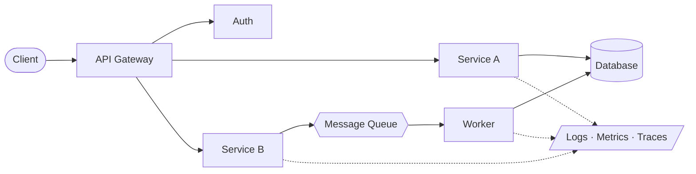

<div align="center">


<a href="https://github.com/alzamiarafat">
  
</a>


</div>

<br/>

```bash
alzamiarafat@github:~$ cat about.md

I build backend systems and care about the boring parts:
clear contracts, predictable failures, and code that's easy to change.
FinTech is where I like to work, since correctness isn't optional there.
```

<br/>

## `~/mental-model`

> How I like to think about a service.



<br/>

## `~/exploring`

| Area | Focus |
| :-- | :-- |
| 🧱 **Architecture** | service boundaries, layering, designing for change |
| ⚡ **Scalability** | async processing, messaging, resilient integrations |
| 🧭 **System design** | trade-offs, failure modes, consistency |
| 🔧 **Engineering practice** | CI/CD, testing strategy, observability |

<br/>

## `~/stack`

<div align="center">


<br/>

<br/>


</div>

<br/>

## `~/activity`

<div align="center">


</div>

<br/>

## `~/projects`

<!--
  PLACEHOLDER: replace REPO_NAME_1..3 with your real public repo names, delete unused rows.
-->

| Repository | Description |
| :-- | :-- |
| [`REPO_NAME_1`](https://github.com/alzamiarafat/REPO_NAME_1) | _one-line description, replace me_ |
| [`REPO_NAME_2`](https://github.com/alzamiarafat/REPO_NAME_2) | _one-line description, replace me_ |
| [`REPO_NAME_3`](https://github.com/alzamiarafat/REPO_NAME_3) | _one-line description, replace me_ |

<br/>

## `~/contact`

<div align="center">

<a href="https://github.com/alzamiarafat"></a>
<a href="mailto:alzamiarafat00@gmail.com"></a>

<br/><br/>


</div>
